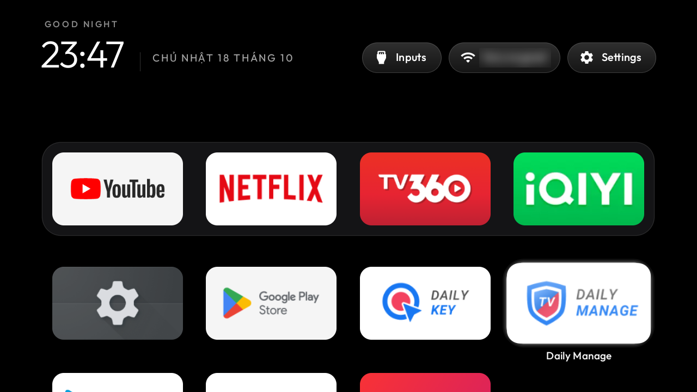

# tv-vibehack · bản cho TV Coocaa

**TV của bạn, không còn quảng cáo.**

🇬🇧 English: [README.md](README.md)

Tắt các app rác và quảng cáo trên TV Coocaa chạy Google TV qua Wi-Fi, rồi thay màn hình chính đầy
gợi ý phim bằng một launcher gọn gàng kiểu Apple TV. Không cần root, không cần cắm cáp, không gỡ
app nào cả. Muốn quay lại như cũ thì chạy đúng một lệnh.

Đây là bản fork của [Gathin23/tv-vibehack](https://github.com/Gathin23/tv-vibehack), có thêm
phần cài đặt đã thử thật trên TV Coocaa.



---

## Mục lục

- [TV nào dùng được](#tv-nào-dùng-được)
- [Kết quả](#kết-quả)
- [Cách nhanh nhất: để AI làm giúp](#cách-nhanh-nhất-để-ai-làm-giúp)
- [Tự làm từng bước trên Windows](#tự-làm-từng-bước-trên-windows)
- [Những app bị tắt](#những-app-bị-tắt)
- [Muốn quay lại như cũ](#muốn-quay-lại-như-cũ)
- [Chỉnh launcher](#chỉnh-launcher)
- [Gặp lỗi thì làm sao](#gặp-lỗi-thì-làm-sao)
- [Câu hỏi thường gặp](#câu-hỏi-thường-gặp)

---

## TV nào dùng được

Đã thử trên **Coocaa 24 inch Full HD Google TV** (model `SWTV-24AE-FHD`, chip MediaTek MT5867,
RAM 1 GB, Android 14). Các TV Coocaa và Skyworth khác **chạy Google TV hoặc Android TV** cũng
dùng chung các app của hãng, nên danh sách này áp dụng được phần lớn.

Kiểm tra nhanh: nếu góc trên màn hình chính có chữ **Google TV**, hoặc trong Cài đặt có mục
**Tùy chọn cho nhà phát triển**, là dùng được.

Không dùng được: TV Coocaa chạy **Coolita OS** (hệ điều hành riêng của hãng, không phải Android
TV), Samsung, LG, Fire TV.

## Kết quả

- Màn hình chính nền đen, đồng hồ lớn, ngày tháng tiếng Việt, lời chào theo giờ.
- Thanh dock 4 app hay dùng nhất ở dưới cùng, bấm xuống để xem các app còn lại.
- Ba nút trên cùng: **Inputs** (chuyển HDMI, AV, truyền hình), **Wi-Fi**, **Settings**.
- Không còn hàng phim đề xuất, quảng cáo, app demo, app thu thập dữ liệu.
- Máy nhẹ hơn: trên TV thử nghiệm, RAM trống tăng từ khoảng **240 MB lên 360 MB**. Launcher chạy
  đều **60 khung hình/giây**.
- Wi-Fi, Bluetooth, remote, loa, tai nghe đã ghép đôi **giữ nguyên**, không phải kết nối lại.

## Cách nhanh nhất: để AI làm giúp

Cần một máy tính chung Wi-Fi với TV và một trợ lý lập trình chạy được lệnh, ví dụ
[Claude Code](https://claude.com/claude-code).

**1. Trên TV: bật chế độ gỡ lỗi**

1. **Cài đặt** → **Hệ thống** → **Giới thiệu**.
2. Kéo xuống dòng **Bản dựng hệ điều hành Android TV** (Android TV OS build), bấm OK **7 lần**
   đến khi hiện "Bạn đã là nhà phát triển". TV hỏi mã PIN thì nhập mã PIN của TV.
3. Bấm Back về **Hệ thống**, vào **Tùy chọn cho nhà phát triển**, bật **Gỡ lỗi USB**.
4. Để TV bật.

**2. Trên máy tính**

Tải repo này về, mở trợ lý AI trong thư mục repo và nói:

> TV Coocaa của tôi chung Wi-Fi với máy này. Làm theo PROMPT.md và dùng
> examples/coocaa-skyworth-beomil/debloat.txt.

**3. Làm theo**

Khi TV hiện bảng **"Cho phép gỡ lỗi USB?"**, tick **Luôn cho phép từ máy tính này** rồi bấm OK.
Sau đó trả lời vài câu hỏi: bạn dùng app nào (YouTube, Netflix, FPT Play, TV360, VTVgo...), app
nào lên dock, có giữ trợ lý giọng nói và Chromecast không. Cả quá trình khoảng 15 đến 30 phút.

## Tự làm từng bước trên Windows

Cần **Python 3** ([python.org](https://www.python.org/downloads/)). Mở PowerShell trong thư mục
repo.

**1. Cài công cụ và kết nối TV**

Tìm IP của TV trong **Cài đặt → Mạng và Internet** trên TV, rồi thay vào chỗ `192.168.1.50`:

```powershell
python -m venv tools\venv; tools\venv\Scripts\python.exe -m pip install -r tools\requirements.txt
$env:TV_HOST = '192.168.1.50'
tools\venv\Scripts\python.exe -I tools\tv.py --probe
```

Lần đầu TV sẽ hỏi "Cho phép gỡ lỗi USB?". Chọn **Luôn cho phép** rồi OK. Kết nối được thì máy in
ra tên model và phiên bản Android của TV.

**2. Sửa danh sách cho hợp với bạn**

Mở [`examples/coocaa-skyworth-beomil/debloat.txt`](examples/coocaa-skyworth-beomil/debloat.txt).
Mỗi dòng là một app sẽ bị tắt. App nào bạn **còn dùng** thì thêm dấu `#` ở đầu dòng để giữ lại.
Nhất là phần cuối "Off by choice": Chromecast, chiếu màn hình, Spotify, FPT Play, VTVgo, WeTV,
YouTube Music, trình duyệt.

**3. Tắt app rác**

```powershell
powershell -ExecutionPolicy Bypass -File tools\disable.ps1 examples\coocaa-skyworth-beomil\debloat.txt
```

**4. Cài launcher mới**

Cần JDK 17 và Android SDK (khoảng 1 đến 2 GB, cài một lần):

```powershell
winget install -e --id EclipseAdoptium.Temurin.17.JDK
```

Tải **Command line tools only** ở [developer.android.com/studio](https://developer.android.com/studio#command-line-tools-only),
giải nén vào `%LOCALAPPDATA%\Android\Sdk\cmdline-tools\latest`, rồi chạy:

```powershell
$env:JAVA_HOME = (Get-ChildItem 'C:\Program Files\Eclipse Adoptium' -Directory | Select-Object -First 1).FullName
& "$env:LOCALAPPDATA\Android\Sdk\cmdline-tools\latest\bin\sdkmanager.bat" "platforms;android-34" "build-tools;34.0.0"
```

Rồi build và cài:

```powershell
powershell -ExecutionPolicy Bypass -File launcher\build-and-install.ps1 -StockLauncher com.google.android.apps.tv.launcherx
```

Bấm nút Home trên remote để xem màn hình mới.

**Lưu ý riêng cho Coocaa Google TV:** Google TV không chịu nhường nút Home cho launcher khác. Vì
vậy script tắt hẳn launcher Google TV gốc. Ngay sau đó Wi-Fi của TV có thể rớt khoảng 30 giây rồi
tự kết nối lại, đây là chuyện bình thường. Trình cài đặt ban đầu của Google sẽ hiện trang báo lỗi
"đã xảy ra sự cố" vì không thấy launcher gốc. Danh sách đã tắt sẵn trình này
(`com.google.android.tungsten.setupwraith`), nên trang lỗi không hiện.

**5. (Tuỳ chọn) Cho app mở nhanh hơn**

Biên dịch sẵn những app hay dùng, mỗi app mất vài phút:

```powershell
tools\venv\Scripts\python.exe -I tools\tv.py 'cmd package compile -m speed -f com.google.android.youtube.tv'
```

Thay tên app tương ứng: Netflix `com.netflix.ninja`, TV360 `com.viettel.tv360.tv`, iQIYI
`com.iqiyi.i18n.tv`, FPT Play `net.fptplay.ottbox`, VTVgo `vn.vtv.vtvgotv`. Nếu báo hết thời gian
chờ thì cứ kệ, TV vẫn biên dịch tiếp ở nền.

## Những app bị tắt

Tất cả chỉ **tắt**, không gỡ. Bật lại lúc nào cũng được.

| Nhóm | Gồm |
|---|---|
| Quảng cáo, gợi ý của Coocaa | hàng phim đề xuất trên màn hình chính, phần chỉnh hàng gợi ý của hãng |
| Công cụ cửa hàng, bảo hành | chế độ demo cửa hàng, ghi nhận kích hoạt, menu bảo hành (có trình cài app ngầm), sách hướng dẫn, app dọn dẹp "Daily Manage" |
| Đồ Google không cần | Feedback, TalkBack, Play Games, đồng bộ lịch, màn hình chờ Ambient |
| Để thay màn hình chính | launcher Google TV gốc và trình cài đặt ban đầu |
| Tuỳ bạn chọn | Chromecast, chiếu màn hình Coocaa, Spotify, FPT Play, VTVgo, WeTV, YouTube Music, trình duyệt |

**Không đụng tới:** HDMI, truyền hình, hình ảnh âm thanh (các app `com.mediatek.*`), remote và
Bluetooth (`com.smartdevice.global.service`), bàn phím ảo, Google Play, cập nhật phần mềm.

App dọn dẹp **Daily Manage** bị tắt vì nó tự đóng các app đang chạy, khiến lần mở sau phải khởi
động lại từ đầu, chậm hơn.

## Muốn quay lại như cũ

Một lệnh bật lại mọi app đã tắt và trả về màn hình Google TV gốc:

```powershell
powershell -ExecutionPolicy Bypass -File tools\restore.ps1 examples\coocaa-skyworth-beomil\debloat.txt -Stock com.google.android.apps.tv.launcherx
```

**Trước khi reset TV về cài đặt gốc**, nhớ chạy lệnh này trước.

Chỉ muốn bật lại một app, ví dụ Spotify:

```powershell
tools\venv\Scripts\python.exe -I tools\tv.py 'pm enable com.spotify.tv.android'
```

## Chỉnh launcher

Mở [`launcher/app/src/main/res/values/config.xml`](launcher/app/src/main/res/values/config.xml):

- `dock_apps`: 4 app trên dock, theo thứ tự từ trái sang phải.
- `hidden_apps`: app không muốn hiện trong lưới.
- `columns`: số cột của lưới.

Sửa xong chạy lại lệnh build ở bước 4. Lấy tên các app trên TV bằng:

```powershell
tools\venv\Scripts\python.exe -I tools\tv.py 'pm list packages -3'
```

## Gặp lỗi thì làm sao

- **Không kết nối được TV:** kiểm tra máy tính và TV cùng một mạng Wi-Fi, **Gỡ lỗi USB** đang
  bật, IP đúng. TV có thể đổi IP sau khi khởi động lại.
- **Không thấy bảng "Cho phép gỡ lỗi USB?":** bảng chỉ hiện khi TV đang bật màn hình. Chạy lại
  lệnh `--probe`.
- **Bấm Home vẫn ra Google TV:** chạy lại bước 4, nhớ có `-StockLauncher com.google.android.apps.tv.launcherx`.
- **TV hiện trang "đã xảy ra sự cố" của Google:** trình cài đặt ban đầu chưa bị tắt. Chạy:
  `tools\venv\Scripts\python.exe -I tools\tv.py 'pm disable-user --user 0 com.google.android.tungsten.setupwraith'`
- **Chụp màn hình TV ra file trống:** TV đang mở HDMI, truyền hình hoặc phim có bản quyền. Bấm
  Home rồi chụp lại.
- **Lỗi `UnicodeEncodeError` trên Windows:** bản này đã sửa. Hãy tải bản mới nhất của repo.

## Câu hỏi thường gặp

**Có làm hỏng TV không?**
Không. Không root, không flash, không xoá gì. App chỉ bị tắt cho người dùng, firmware giữ
nguyên. Có sự cố thì chạy lệnh khôi phục, hoặc bật lại app trong **Cài đặt → Ứng dụng** của TV.

**Có ảnh hưởng Wi-Fi, Bluetooth không?**
Không. Wi-Fi, Bluetooth, remote và thiết bị đã ghép đôi giữ nguyên, tự kết nối như trước.

**TV cập nhật phần mềm thì sao?**
Danh sách này không tắt trình cập nhật. Nếu sau khi cập nhật có app bật lại, chạy lại bước 3.

**Có cần để Gỡ lỗi USB bật mãi không?**
Không. Làm xong có thể tắt đi, launcher vẫn chạy bình thường. Khi muốn chỉnh tiếp thì bật lại.

**Có bản APK cài sẵn không?**
Không. Bạn tự build trong khoảng một phút để biết chắc cái gì được cài lên TV.

## Giấy phép

MIT, xem [`LICENSE`](LICENSE). Tác giả gốc: Gathin. Font Outfit theo giấy phép SIL Open Font
License.
